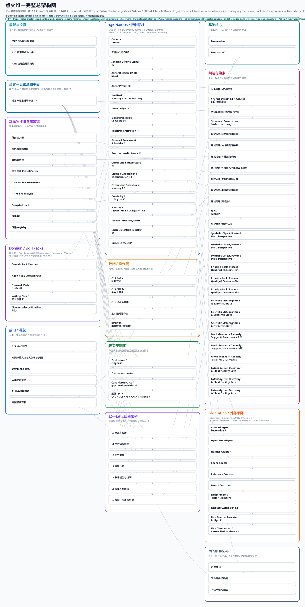

# When Systems Catch Fire / 点火

## 1. 项目与价值

### 点火是什么

**点火首先是一种面对未知的精神：不把已有的认识当作世界的终点，不把尚未理解的事物简单排除，也不因为一个解释足够漂亮，就停止追问它是否成立。**

世界并不是一份等待照抄的答案。事物在相互作用中改变，影响继续传播，新的条件又会改变后来发生的事情。我们能够观察、记录、提出解释，却不能因此占有最后的解释权。一次判断可能被新证据修正，一种方法可能在另一种条件下失败，一项曾经有用的技术也可能失去价值。点火所珍视的，正是**继续观察、容纳反例、承认未知、允许修订与重新开始的能力**。

点火因此不是某一套固定代码，不等于某个模型的智力，也不是宣称已经找到世界运行规律的理论。它希望把零散的阅读、研究、思考、实验和创作接续起来：一个问题从何而来，采用了哪些来源，依据与猜测分别是什么，发生过哪些失败，结论在什么条件下成立，又如何影响下一个问题。**让一次探索不仅留下答案，也留下别人能够继续检验和修正的路径。**

为了使这种追求不只停留在愿望上，我们正在建设与之相配的工具：保存来源和版本，组织证据与反例，记录任务和真实结果，在需要时协调可替换的 Agent、程序与执行环境，并把有价值的积累转化为读者能够理解的作品。它们是承载点火的手段，而非点火的全部；任何组件都可以被改进、替换或撤回。

**点火不是要求世界服从一个体系，而是让体系持续接受世界的检验。**

### 价值方向

> 长瞻一宇同叩月，此心相契共今宵。

点火愿意把目光放在更长的时间、更广阔的生命与尚未被理解的主体上，也愿意保护眼前真实存在的人及其选择。效率、增长和技术能力并不自动赋予行动正当性；任何值得推进的工作，都应考虑谁会受益、谁承担代价、能否纠错以及能否退出。

完整原则见[《生命共同体价值宪章》](../ignition/docs/governance/life-community-value-charter.md)。宪章表达规范性立场，不是科学事实、数学证明或对任何智能体道德地位的预先判定。

### 现在做到哪里

今天的点火已拥有可审计的仓库工程、知识与证据记录、研究和写作入口，以及带边界的 Agent 协调原型。它仍在发展：有些能力只有离线测试证据，有些研究仍为候选或负结果，真实外部执行和独立科学认可也不能从一次测试或合并自动推得。

请以[当前工程事实](../ignition/docs/architecture/current-facts.md)、[当前结果](../ignition/RESULTS/LATEST.md)和[开放问题](../ignition/RESULTS/OPEN-QUESTIONS.md)了解**已经证实的能力与尚未完成的工作**。我们欢迎新结果，也保留旧错误的记录；进展不是让未完成变成“通过”，而是让下一步可以真正继续。

## 2. 点火操作法 / 如何使用

**从一个真实问题或对象开始。** 它可以是一篇文章、论文、一组数据、一份笔记、一段代码，或者一个尚未找到合适表述的问题。你无需先理解整个仓库，也不必先接受点火的任何结论。

把对象、目的和本仓库链接交给可读取仓库的 Agent，要求它先读取[当前点火操作法](../ignition/OPERATING-METHOD.md)与[能力注册表](../ignition/data/operations/ignition-operation-capability-registry-r1.json)，再选择适用的步骤。默认仅作只读处理；提供对象不意味着授权修改仓库、联网操作或替你决定目标。

> 请读取[点火仓库](https://github.com/Arvin-liu/when-systems-catch-fire)中的 Current 操作法，处理我附上的对象。区分来源、事实、推论与未知，给出实际结果、证据、失败和下一步；不要把尚未验证的结论写成已证实。

如果希望改变点火系统自身，请另行明确说明，并阅读[迭代操作法](../ignition/ITERATION.md)；普通读者从[人类阅读路线](../ignition/HUMAN-READING.md)开始，Agent 从[AI 冷启动](../ignition/AI-START-HERE.md)开始。工具与接口有版本和权限边界，**能在页面找到，不等于已经可以在现实环境中调用**。

## 3. 结果与火种

点火的成果不只包括得到支持的判断，也包括被排除的假设、不能复制的结果、留下的反例、需要补足的证据，以及从一次研究中萌生的新问题。它们的状态应当可以被读者分辨，而不是被统一包装成“成功”。

建议先读[《火种：点火跑出来的发现、问题与写作种子》](../ignition/PUBLICATIONS/pointfire-results-book/12-火种：点火跑出来的发现、问题与写作种子.md)，再按兴趣进入[点火成果册](../ignition/PUBLICATIONS/pointfire-results-book/README.md)、[当前结果](../ignition/RESULTS/LATEST.md)、[纠正与撤回](../ignition/RESULTS/CORRECTIONS.md)及[开放问题](../ignition/RESULTS/OPEN-QUESTIONS.md)。

若需要核查具体的知识资产，可进一步阅读[函数资产](../ignition/docs/human/function-assets/README.md)和[非函数资产](../ignition/docs/human/nonfunction-assets/README.md)。来源归档、工程验收、数学证明、现实证据和人工科学审阅是不同层次；一个环节完成，不代表其他环节已经完成。

## 4. 整体架构

点火把目标与价值判断、记忆与证据、行动与验证、Agent 与工具、成果与撤回连接在一起。架构图展示**当前仓库记录下的组织关系**，不是对现实因果的完整刻画，也不是所有组件都已投入实际运行的保证。

[全屏打开交互式架构图](https://arvin-liu.github.io/when-systems-catch-fire/architecture/?present=1) · [阅读模式](https://arvin-liu.github.io/when-systems-catch-fire/architecture/) · 可缩放、拖动、搜索节点并查看关联。

[点火工具箱 / 工具身份卡](../ignition/TOOLBOX.md) · 浏览工具的能力、限制、权限、依赖、证据和回退边界。

组件导航：核心控制与状态

- [Ignition Generic Kernel](../ignition/agent_kernel/README.md)
- [Agent Runtime](../ignition/agent_runtime/README.md)
- [OS Control Plane](../ignition/docs/architecture/os-control-plane-r2.md)
- [Steering / Intent / Goal / Obligation](../ignition/docs/architecture/os-steering-intent-r1.md)

组件导航：执行与协作

- [External Agent Federation](../ignition/docs/architecture/external-agent-federation-r1.md)
- [Executor Admission](../ignition/docs/architecture/external-agent-federation-r1.md#provider-neutral-executor-admission)
- [Live External Executor Bridge](../ignition/docs/architecture/external-agent-federation-r1.md#live-external-executor-bridge-r1)
- [Reference Executor](../ignition/docs/architecture/external-agent-federation-r1.md#reference-executor-freeze)

组件导航：研究与知识

- [统一知识入口](../ignition/KNOWLEDGE/README.md)
- [Foundation](../ignition/FOUNDATION.md)
- [MCF 多尺度因果织体](../ignition/docs/architecture/multiscale-causal-fabric.md)
- [PSD 概率系统动力学](../ignition/docs/architecture/probabilistic-system-dynamics.md)
- [ARN 自适应关系网络](../ignition/docs/architecture/adaptive-relational-network.md)

组件导航：人类入口与成果

- [人类使用说明](../ignition/docs/USAGE.md)
- [当前项目现状](../ignition/docs/project-current-state.md)
- [之元写作法](../ignition/docs/publication/zhiyuan-writing-method.md)
- [成果索引](../ignition/docs/publication/zhiyuan-writing-showcase.md)

组件导航：治理与边界

- [生命共同体价值宪章](../ignition/docs/governance/life-community-value-charter.md)
- [Human Surface 编辑契约](../ignition/docs/governance/human-surface-editorial-contract.md)
- [认识论治理内核与联邦平面](../ignition/docs/architecture/epistemic-governance-kernel-and-federated-planes.md)
- [智能体化边界](../ignition/docs/architecture/agentization-boundary-r0.md)
- [许可与权利边界](../ignition/docs/governance/licensing-rights-inventory.md)

## 5. 致谢

感谢每一个提出问题、保留异议、指出错误、记录失败、维护证据、制作工具和认真阅读的人。点火的延续依赖这些具体劳动，也依赖维护者能够有尊严、可持续地生活和工作。

我们并不期待所有读者同意点火的价值判断，也不把反对意见当作必须消除的故障。**让质疑有入口，让结论有边界，让新的参与者能够从已经留下的证据继续工作**，比维护一幅永远完美的项目形象更重要。

参与方式见[参与说明](../ignition/docs/participate.md)与[支持说明](SUPPORT.md)。资金、赞助或商业合作不能购买证据等级、科学结论、治理权或合并权。使用和许可范围以[根目录 LICENSE](../LICENSE)及[许可说明](../ignition/LICENSES/README.md)为准。
